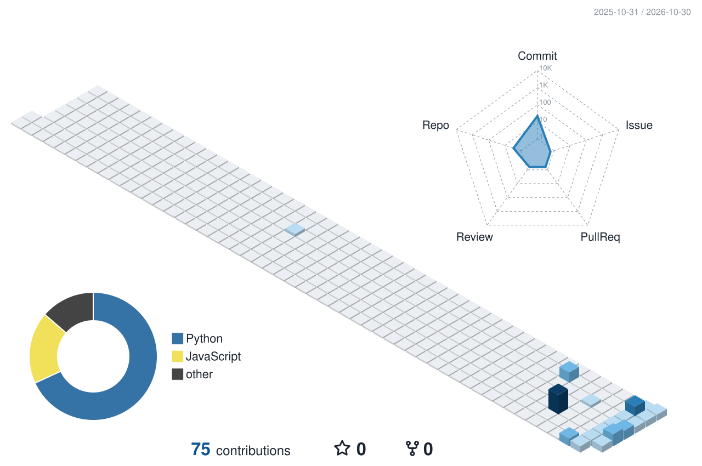

<picture>
  <source media="(max-width: 600px) and (prefers-color-scheme: dark)" srcset="assets/hero-mobile-dark.svg">
  <source media="(max-width: 600px)" srcset="assets/hero-mobile-light.svg">
  <source media="(prefers-color-scheme: dark)" srcset="assets/hero-dark.svg">
  <source media="(prefers-color-scheme: light)" srcset="assets/hero-light.svg">
  
</picture>

<a href="mailto:chxnho@gmail.com"><picture><source media="(prefers-color-scheme: dark)" srcset="assets/contact-email-dark.svg"></picture></a><a href="https://github.com/Indispensable-AI"><picture><source media="(prefers-color-scheme: dark)" srcset="assets/contact-team-dark.svg"></picture></a><a href="https://github.com/chxnho?tab=repositories"><picture><source media="(prefers-color-scheme: dark)" srcset="assets/contact-repos-dark.svg"></picture></a>

### Making knowledge useful for learning

I structure curricula as **knowledge graphs** and explore how connected knowledge can help explain students’ mistakes and support personalized feedback. My work brings together **ontology, GraphRAG, and agentic systems** for education.

<picture>
  <source media="(max-width: 600px) and (prefers-color-scheme: dark)" srcset="assets/workflow-mobile-dark.svg">
  <source media="(max-width: 600px)" srcset="assets/workflow-mobile-light.svg">
  <source media="(prefers-color-scheme: dark)" srcset="assets/workflow-dark.svg">
  <source media="(prefers-color-scheme: light)" srcset="assets/workflow-light.svg">
  
</picture>

### Research focus

**Knowledge representation** · Connecting curriculum standards, concepts, and prerequisite relationships through knowledge graphs and ontologies.

**Learning diagnosis** · Exploring graph-grounded retrieval and reasoning to investigate the causes behind incorrect answers.

**Educational agents** · Developing agentic retrieval and multi-agent workflows for learning support and personalized feedback.

### Toolkit

| Area | Technologies & methods |
| :--- | :--- |
| **Graphs & semantics** | Neo4j · Cypher · RDF · OWL · Ontology |
| **Retrieval & agents** | GraphRAG · LangChain · LangGraph · Agentic RAG |
| **Models & experimentation** | Python · PyTorch · Hugging Face · Local LLMs · Synthetic data |
| **Development** | Git · GitHub · Jupyter · VS Code |

<b>Contribution landscape</b>

 

<picture>
  <source media="(prefers-color-scheme: dark)" srcset="profile-3d-contrib/profile-chxnho-rainbow.svg">
  
</picture>

---

Building indispensable solutions through data, graphs, and intelligent systems.

